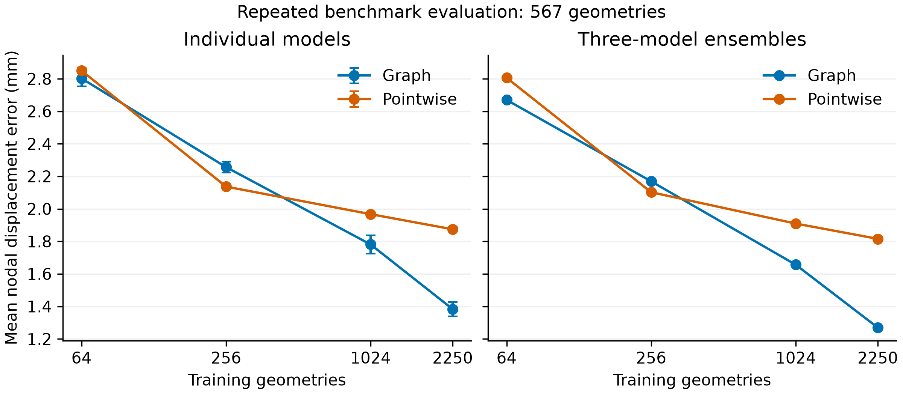

# Cardiac surrogate learning curves

Controlled comparison of graph and pointwise neural networks for passive left ventricular deformation, examining how prediction accuracy changes with training-set size.

**Research question:** When do graph networks improve cardiac surrogates?

The completed study trains 24 models on the published Dalton ventricular deformation benchmark. It compares nested training subsets, approximately matched model capacities, paired random seeds and equally sized ensembles. The networks learn from discrete finite-element displacement labels; this experiment does not use a physics-informed loss.

## Results

Mean nodal Euclidean displacement errors on 567 test geometries from run `cmbbe-data-efficiency-01`:

| Training geometries | Individual graph (mm) | Individual pointwise (mm) | Graph ensemble (mm) | Pointwise ensemble (mm) |
| ---: | ---: | ---: | ---: | ---: |
| 64 | 2.802 ± 0.048 | 2.850 ± 0.017 | 2.670 | 2.806 |
| 256 | 2.257 ± 0.034 | 2.137 ± 0.011 | 2.169 | 2.102 |
| 1,024 | 1.781 ± 0.057 | 1.967 ± 0.005 | 1.656 | 1.909 |
| 2,250 | 1.383 ± 0.043 | 1.874 ± 0.014 | 1.270 | 1.816 |

Individual-model values are the mean ± sample standard deviation of the three seed-level mean errors. Ensemble errors are calculated after averaging the three displacement predictions; they are not averages of member errors.

At 2,250 training geometries, graph models reduced mean individual-model error by **26.2%** relative to pointwise models. The paired graph-minus-pointwise difference was **−0.491 mm**, with a conditional geometry-bootstrap 95% interval of **[−0.546, −0.438] mm**. The matched graph ensemble reduced error by **30.1%**.

The advantage depends on the evaluated training size: pointwise models performed better at 256 geometries, while the individual-model difference at 64 geometries had an interval spanning zero. These results do not establish a universal advantage for graph networks.



The individual-model error bars show seed standard deviations, not confidence intervals. See the [accuracy table](reports/data_efficiency_01/accuracy-review/accuracy-table.csv), [paired-difference figure](reports/data_efficiency_01/accuracy-review/02-paired-differences.png) and [captions and limitations](reports/data_efficiency_01/accuracy-review/captions-and-limitations.txt).

## Experimental design

| Component | Specification |
| --- | --- |
| Training data | Nested subsets of 64, 256, 1,024 and 2,250 geometries |
| Subset construction | One fixed permutation, seed 2027; identical subsets for both architectures |
| Validation data | All 150 author validation geometries, used for checkpoint selection |
| Test data | All 567 author test geometries; 6,784 corresponding nodes per geometry |
| Models | Multiscale graph network and pointwise multilayer perceptron |
| Parameters | Graph: 132,419; pointwise: 132,243 |
| Model seeds | 11, 22 and 33 for both architectures; 24 trained models in total |
| Inputs | Raw coordinates, ten node features and four global features; graph model also uses the fixed supplied hierarchy |
| Preprocessing | Normalisation fitted separately on each selected training subset |
| Initialisation | Random, from scratch; supplied model weights, normalisers and shape coefficients are unused |
| Training | Common AdamW and cosine learning-rate policy; batch size 32; 256 cyclic node queries per geometry per epoch |
| Selection | Full-field validation every five epochs; maximum 500 epochs; patience of 25 validation checks |
| Primary metric | Mean Euclidean nodal displacement error, reported in mm; raw displacement units are cm |
| Ensembles | Three members per architecture; predictions averaged before error calculation |
| Intervals | 10,000 paired geometry-bootstrap resamples; seed errors averaged within each geometry for individual-model comparisons |

The settings are in [configs/gnn/data_efficiency.json](configs/gnn/data_efficiency.json). Intervals are conditional on the fixed subsets and seeds; they do not measure uncertainty from drawing different training subsets. Seed variability is reported separately. The intervals are pointwise and are not adjusted for multiple comparisons.

## Data and attribution

The study uses synthetic left ventricular geometries and finite-element displacement labels supplied by Dalton, Gao and Husmeier:

1. Dalton D, Gao H, Husmeier D. *Emulation of cardiac mechanics using Graph Neural Networks*. Computer Methods in Applied Mechanics and Engineering. 2022;401:115645. [Article DOI](https://doi.org/10.1016/j.cma.2022.115645).
2. Dalton D, Gao H, Husmeier D. *Data From: Emulation of Cardiac Mechanics using Graph Neural Networks*. Zenodo; 2022. [Dataset DOI](https://doi.org/10.5281/zenodo.7075055).

Original data and upstream code are not bundled with this repository. Preserve upstream attribution and licences; see [LICENSES_AND_ATTRIBUTION.md](LICENSES_AND_ATTRIBUTION.md). No licence for this project's new research code is implied by the upstream licences.

Stage the original arrays under `data/raw/lvData/rawData/{train,validation,test}/`. Each split requires `real-node-coords.npy`, `real-node-features.npy`, `global-features.npy` and `real-node-displacement.npy`.

The upstream [passive-lv-gnn-emul](https://github.com/dodaltuin/passive-lv-gnn-emul) checkout must resolve through `external/passive-lv-gnn-emul/`, at recorded revision `449cc22459ba5ada344fe0ff238e6b586d5e9319`. Its `data/lvDataFixedGeom/topologyData/` directory supplies `kmeans-labels-list.npy`, `node-layer-labels.npy` and `sparse-topology.npy`. The launcher checks these inputs before submission and records input hashes during preparation.

## Reproduce on the HPC

Run commands from the repository root. On the existing cluster checkout this is `$HOME/CMBBE/cardiac-lv-surrogate`; changing the GitHub repository name does not require changing that local directory.

The controller uses `.venv/bin/python` with NumPy. GPU training uses the separate `.hpc/surrogate-ml` environment, provisioned by [hpc/setup_surrogate_torch.sh](hpc/setup_surrogate_torch.sh) inside the allocation. Its default Python seed is the existing `.hpc/native-v2/bin/python`; `SURROGATE_PYTHON` can specify an alternative compatible Python when preparing the ML environment. Binary dependencies are pinned to PyTorch 2.5.1 with CUDA 11.8, NumPy 1.26.4, SciPy 1.14.1 and Matplotlib 3.9.4. First-time setup requires package-index network access. A compatible pre-existing ML environment can be supplied with `--python /absolute/path/to/python`.

Submit a reproduction under a new run ID, preserving the completed experiment:

```bash
.venv/bin/python hpc/launch_data_efficiency.py submit --run-id cmbbe-data-efficiency-reproduction-01
```

The site-specific PBS launcher requests `iworkq`, 28 CPU cores, 240 GB RAM, four GPUs and a 168-hour exclusive allocation. Four independent workers dynamically claim unfinished model runs, with one worker per GPU and six CPU threads per worker. Each GPU must pass a real forward/backward check against CPU predictions and gradients.

Epoch checkpoints retain optimiser, scheduler and RNG state. Allocation pauses automatically queue a successor, with no aggregate experiment-hour cap. Scientific and runtime failures stop the experiment and retain its checkpoints. After an interrupted allocation has ended, resume its existing run ID:

```bash
.venv/bin/python hpc/launch_data_efficiency.py resume --run-id cmbbe-data-efficiency-reproduction-01
```

Monitor the run and PBS queue:

```bash
cat experiments/hpc/cmbbe-data-efficiency-reproduction-01/state.json
qstat -u "$USER"
```

Training opens only training and validation data. Test evaluation starts after all predeclared models finish. Frozen source, protocol, prepared-data and environment checks protect resumptions from silently mixing versions. GPU reductions may still introduce numerical differences between retrainings; identical seeds do not guarantee bitwise-identical results.

See [the detailed runbook](hpc/data_efficiency_runbook.txt) for setup, logs and allocation recovery. This workflow uses the supplied FE labels and does not require generating a new mechanics trajectory.

## Generate conference figures and tables

On the cluster, consolidate the completed run's saved measurements:

```bash
run="$PWD/experiments/hpc/cmbbe-data-efficiency-01"
.hpc/surrogate-ml/bin/python scripts/report_data_efficiency.py --run "$run" --output "$run/conference-report"
```

Choose a new output directory if that report already exists. Reporting reads saved artifacts and runs on CPU; it does not train models or repeat test inference.

The full report contains four figures in 300-dpi PNG and vector SVG, accuracy and cost/tail-error tables in CSV and LaTeX, captions, numerical results text, per-geometry errors, original timing measurements, runtime metadata and source/input hashes. Single-model costs are averaged over seeds; ensemble training costs sum member times. Inference timing covers warmed, synchronised, device-resident, batch-one full-field prediction, excluding input transfer and preprocessing. Training cost is elapsed worker time, not utilisation-weighted GPU time or total PBS allocation walltime.

The committed [accuracy review](reports/data_efficiency_01/accuracy-review/) was generated from the supplied completed-run terminal transcript, with [source provenance](reports/data_efficiency_01/source/provenance.json). It contains accuracy results only. The full measured-cost/tail report was generated on the HPC and remains in its ignored run directory; those measurements are not inferred in the committed review.

## Validation scope

- All 567 test geometries had been evaluated in earlier project work involving surrogate development and ensembles. This is repeated benchmark evaluation, not an untouched prospective test.
- Current checkpoints were selected using validation data. Prior knowledge of test performance remains a limitation for the broader research process.
- Results describe approximation of discrete FE labels on the supplied synthetic geometry distribution. They do not establish clinical validity, mesh-independent continuum accuracy or generalisation to anatomical populations or new topologies.
- The experiment does not establish a physics-informed training advantage or a matched speedup over an FE solver.

## Code and artifacts

| Path | Purpose |
| --- | --- |
| `configs/gnn/data_efficiency.json` | Frozen study settings |
| `scripts/data_efficiency.py` | Subset preprocessing, training and paired test evaluation |
| `src/lv_surrogate/models/multiscale.py` | Graph encoder and point decoder architecture |
| `hpc/launch_data_efficiency.py` | Four-GPU PBS scheduling and checkpoint recovery |
| `scripts/report_data_efficiency.py` | Conference figures, tables and provenance checks |
| `tests/test_data_efficiency.py` | Split control, capacity, training recovery and scheduling checks |
| `tests/test_data_efficiency_report.py` | Reporting units, completeness and consistency checks |
| `reports/data_efficiency_01/` | Committed accuracy figures, tables and reported-result provenance |
| `experiments/hpc/<run-id>/` | Ignored cluster run artifacts, checkpoints and full reports |

In a development environment with the project dependencies and pytest installed:

```bash
.venv/bin/python -m pytest tests/test_data_efficiency.py tests/test_data_efficiency_report.py -q
```

The repository also retains earlier replication, uncertainty-analysis and mechanics-solver experiments. Their scripts, configurations and Makefile targets are historical research material; their results are separate from this 24-model study. Raw data, environments, checkpoints and cluster run directories are excluded from Git. The package name `lv_surrogate` and existing directory names remain unchanged.
