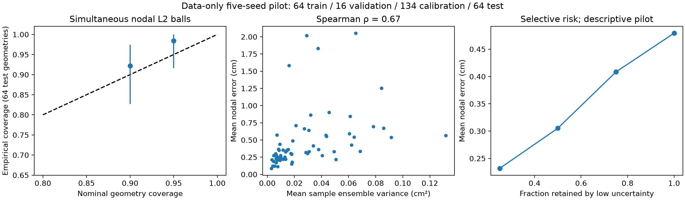

# Executed results — 2026-10-16

All values computed from real Dalton FEM displacement data; no clinical claim. B0 is a released-weight numerical reproduction on modern Flax, not an identical legacy runtime. B2/U1 is a prespecified small data-only pilot, not a full-scale replacement or physics-informed result.

| Model/task | Train cases | Test cases/geometries | Mean nodal L2 (cm) | Mean case component RMSE (cm) |
|---|---:|---:|---:|---:|
| Released fixed decoder | author pretrained | 246 / 1 | 0.018172 | 0.011391 |
| Released varying GNN | author pretrained | 567 / 567 | 0.041037 | 0.026234 |
| Five-seed modern pilot | 64 | 64 / 64 | 0.479376 | 0.295223 |
| Training-fitted constant vector mean baseline | 64 | 64 / 64 | 0.989261 | — |

The released GNN is evaluated on a larger test cohort and uses a much larger training budget. These rows are not a matched architecture/budget comparison. Pilot is far less accurate; no superiority claim.
Pilot geometry bootstrap 95% CI for mean nodal L2: [0.3866081729531288, 0.5922736704349517]; resample test geometries with fixed trained ensemble, 2000 bootstrap replicates. This excludes training-seed variability. Five individual seed errors are in ensemble_pilot.json.

| Nominal simultaneous coverage | Test coverage | Radius (cm) | Exact binomial 95% interval |
|---|---|---|---|
| 90% | 59/64 (92.19%) | 2.3225 | [0.8270216709957924, 0.974146159832032] |
| 95% | 63/64 (98.44%) | 2.8327 | [0.9159896735656463, 0.9996044874859493] |

Separate calibration: 134 geometries. Whole-geometry max-node L2 score and corrected split-conformal order statistic. Wide balls reflect poor pilot accuracy. Raw ensemble variance is not itself calibrated. Spearman variance/error association 0.6736; selective-risk values saved. Exchangeability assumed; shift calibration/generalization not established.

Total five-seed training wall time (sum of separate seed timings): 128.74 s. Each seed: 19,619 parameters; 640 optimizer updates. Costs exclude preprocessing/install/data generation.

Physics-guided comparison, FE strain/stress errors, matched FEM timing, OOD shift and final submission evidence: not complete. Kinematic verification and synthetic unit checks are reported separately; no equilibrium gain claimed.

