# Executed research results

All results are computational. Released-model inference uses unedited author equations under modern Flax, not an identical legacy runtime. Graph connectivity alone does not establish FE mechanics.

**Full-cycle follow-up (2026-10-17).** This is a new passive numerical benchmark task. The earlier1ms acceleration-increment model remains a failed recursive pilot; the new model uses5ms steps and a different recurrent formulation. Stability improvements cannot be attributed to one change alone. No active electromechanical or clinical claim follows.

**Numerical validation gate remains unmet.** Full-cycle mesh refinement changes displacement by 13.12%, exceeding the stated1% tolerance. The5ms temporal target also misses1%. All model improvements and calibration below refer to the coarse discrete reference; they exclude FE discretization uncertainty and do not establish continuum accuracy.

**Reference-change counterexample.** On one known baseline geometry/loading, changing from P1/5ms to P2/1.25ms changes FE labels by2.522mm nodal component RMSE. The original nominal95% regions miss the changed reference for4/4 ensembles on this SINGLE case. This is combined element/timestep sensitivity, not a population coverage estimate; P2 is not assumed continuum truth.

**Controlled reference diagnosis.** P2 timestep sensitivity between1.25ms and1ms is 0.0459%, passing the1% test on one baseline case. In a separate fixed1ms, same-mesh P1/P2 comparison, changing displacement degree changes full-cycle volume-L2 displacement by 24.177%. Thus a large polynomial-order sensitivity remains after matching timesteps. P2 mesh convergence and finer-reference population uncertainty remain unvalidated.

**Protocol and split.** Thirty-two independent numerical geometry draws from one affine benchmark ellipsoid family. Eight training trajectories on four geometries, four validation trajectories on two geometries, twenty calibration trajectories on twenty geometries, and four primary test trajectories on four geometries. Four additional loading-shift trajectories share the four test geometries; four combined shape/loading-shift trajectories use two further geometries. All are200-step trajectories from zero histories over0.005–1s. No geometry spans training/validation/calibration/test roles. Calibration and primary test independently draw the same numerical shape and waveform-descriptor distribution. Load amplitude/timing perturbations are numerical sensitivity inputs, not empirical physiology.

Reference collection: 47/47 planned accepted trajectories complete, including convergence variants. The44-trajectory cohort is separate from these convergence repeats. Every newly accepted step requires a positive SNES convergence reason, finite residual below1e-6N and positive endpoint element determinants. Failed10ms attempts and refined5ms retries are retained. The source legacy convergence flag could be negative/truthy; explicit positive-reason checks correct that issue. Earlier archived1ms states were independently checked to have finite small residuals.

**Neural method and controls.** A64-node graph encoder (width32, two message rounds) conditions a64-state GRU. Each update receives the previous predicted displacement coefficients and current/previous prescribed pressure. A bounded tanh readout returns rank12 uncentered POD coefficients. The hidden state and displacement start at zero; all200 predictions are generated without true displacement/velocity/acceleration histories. Bounded coefficients do not mathematically guarantee positive Jacobians or mechanical equilibrium. Endpoint Jacobians are checked separately.

POD and coefficient/derivative scales use labelled training fields only. The displacement loss is physical field MSE divided by training field RMS squared, with0.1/0.01 physically scaled first/second time-difference losses. Exact orthonormal-POD identities evaluate these losses in coefficient space. The initial equal-normalized-mode pilot is preserved as a validation-only unsuccessful design. Matched arms share400 warm supervised updates, then250 further data-only or physics updates from exactly the same warm checkpoint. The warm checkpoint remains eligible. Five seeds11/22/33/44/55 are used. Physics weight grids come from training-only parameter-gradient balance and are selected on native float64 validation force residual subject to at most10% displacement-RMSE degradation.

The full regime labels all four training geometries. The limited regime labels only one geometry/two trajectories, fits its own POD/scales, and uses the remaining three training geometries as unlabelled residual collocation inputs. Their displacement/history arrays are not read by limited-data preprocessing. Both arms have the same input descriptors and labelled targets; validation labels and optimizer budgets are matched. This limits training labels, not the total simulation cost of constructing this research cohort.

The full nonlinear weak residual includes source anisotropic passive elasticity, viscosity, generalized-alpha inertia, Robin terms and follower pressure. Histories are derived causally from the complete predicted displacement sequence through the exact source Newmark maps. CPU float32 neural training is linked differentiably to MPS float32 residual evaluation; final inference/mechanics use CPU/native float64. MPS scatter accumulation is not bitwise deterministic, despite seeded runs.

Independent5ms verification passed: largest CPU64 force/tangent relative error 2.74e-12; largest GPU32 force/tangent error 0.0021; coupled-history derivative relative error 2.53e-11.

Actual frozen recurrent neural physics gradient verified against native directional finite differences through the complete predicted-history chain: norm2.9176, relative discrepancy7.97e-08, training case only.

**Frozen primary evaluation.** All20 selected checkpoints were hashed before held-out ML evaluation. The deployment candidate is chosen from ensemble validation only, before calibration/test labels are opened. Geometry-cluster bootstrap intervals condition on the fixed models and only four independent test geometries; they exclude retraining and FE uncertainty. Mechanics are evaluated at nine preregistered frames, including startup and the final endpoint. Inversions are checked over every tetrahedron and every one of200 endpoints, for ensembles and each individual test member.

| Ensemble | Test component RMSE(mm) | Relative RMSE | Mean sampled force RMS | Complete non-inverted cycles | Min endpoint detF |
|---|---:|---:|---:|---:|---:|
| full/data | 0.440900 | 5.270% | 0.0562738 | 4/4 | 0.54664 |
| full/physics_10 | 0.602333 | 7.183% | 0.0370801 | 4/4 | 0.57851 |
| limited/data | 0.754152 | 9.031% | 0.175939 | 4/4 | 0.51299 |
| limited/physics_1 | 0.720657 | 8.596% | 0.0514487 | 4/4 | 0.54589 |

| Regime | Physics/data RMSE ratio | Paired mean force-RMS difference | Conditional geometry bootstrap95% interval |
|---|---:|---:|---|
| full | 1.366146 | -0.0191937 | [-0.021567838025403907, -0.016819640747231333] |
| limited | 0.955586 | -0.12449 | [-0.22044450778506103, -0.05001128320170625] |

Validation-selected deployment candidate: **full/physics_10**. Per-seed displacement/mechanical errors, per-case strain/energy errors, invalid fields and conditional comparisons are in dynamic_final_evaluation.json. Lower residual must be considered together with displacement error and failure counts; no population-level significance claim is supported by four test geometries.

**Joint trajectory calibration.** Each score is the maximum nodal L2 displacement error across all4577 nodes and all200 time steps for one independent geometry/waveform pair. Twenty separate calibration geometries permit finite corrected90% and95% radii. These balls target the coarse5ms numerical reference, not continuum or patient truth.

| Ensemble | Nominal | Joint test geometry coverage | Radius(mm) | Exact binomial95% interval |
|---|---:|---:|---:|---|
| full/data | 90% | 4/4 | 4.7693 | [0.3976353643835254, 1.0] |
| full/data | 95% | 4/4 | 4.8167 | [0.3976353643835254, 1.0] |
| full/physics_10 | 90% | 4/4 | 7.2154 | [0.3976353643835254, 1.0] |
| full/physics_10 | 95% | 4/4 | 7.2167 | [0.3976353643835254, 1.0] |
| limited/data | 90% | 3/4 | 7.4839 | [0.19412044968324343, 0.9936905367902901] |
| limited/data | 95% | 4/4 | 7.8429 | [0.3976353643835254, 1.0] |
| limited/physics_1 | 90% | 3/4 | 8.5823 | [0.19412044968324343, 0.9936905367902901] |
| limited/physics_1 | 95% | 4/4 | 9.0836 | [0.3976353643835254, 1.0] |

A four-geometry test gives very wide coverage intervals. Raw ensemble variance is reported separately and is not a calibrated interval. Uncertainty/error associations on only four cases are descriptive.

**Changed loading and rejection.** Input support is fixed at radius scales[.95,1.05], amplitude[.9,1.1] and timing scale[.95,1.05]. Known requests outside these ranges, missing/nonfinite descriptors, or invalid predicted Jacobians route to FE. This is explicit support checking, not a learned detector of every possible distribution shift or a correctness guarantee inside the box. Shift errors below are NN errors before routing; FE reference replacements are never counted as NN accuracy.

| Model | Shift type | NN RMSE(mm) | Non-inverted cycles | FE routes | Nominal90% joint geometry coverage |
|---|---|---:|---:|---:|---:|
| full/data | load_shift | 0.49026 | 4/4 | 4/4 | 4/4 |
| full/data | shift | 1.23233 | 4/4 | 4/4 | 0/2 |
| full/physics_10 | load_shift | 0.68590 | 4/4 | 4/4 | 1/4 |
| full/physics_10 | shift | 1.20600 | 4/4 | 4/4 | 0/2 |
| limited/data | load_shift | 0.81617 | 4/4 | 4/4 | 2/4 |
| limited/data | shift | 1.80579 | 4/4 | 4/4 | 0/2 |
| limited/physics_1 | load_shift | 0.78334 | 4/4 | 4/4 | 2/4 |
| limited/physics_1 | shift | 2.01705 | 4/4 | 4/4 | 0/2 |

Shift coverage has no exchangeability guarantee; trajectories on the same geometry are grouped. Rejected requests incur FE latency. No globally rapid or universally reliable hybrid system is claimed.

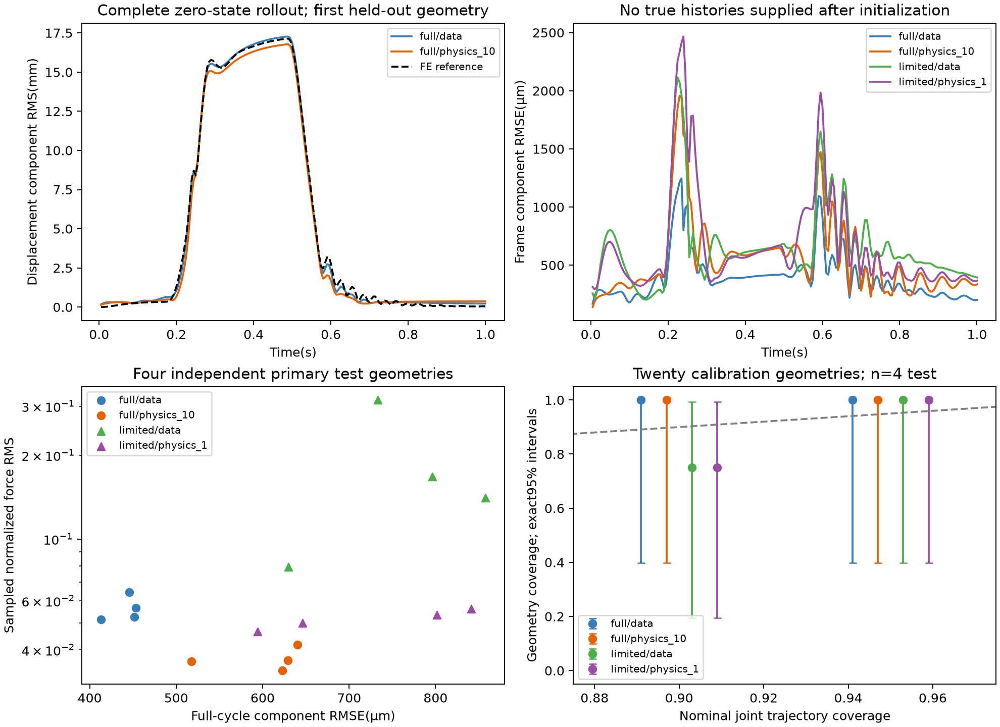

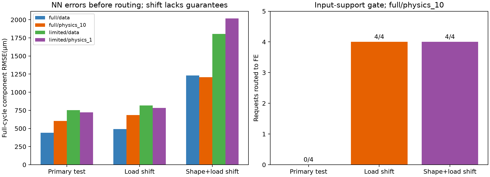

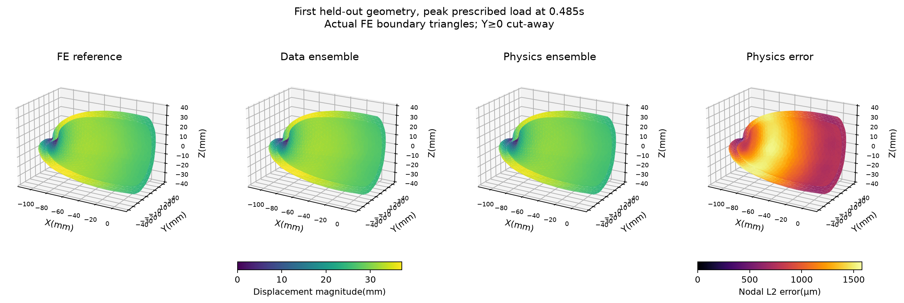

**Independent fixed-model confirmation.** Sixteen additional geometry/waveform draws were specified in a fixed config after checkpoint freezing and before inspecting the primary test results. The checkpoint hashes, method choices, feature transformations and20 original calibration scores/radii remain unchanged. These sixteen draws match the primary/calibration numerical distribution. Results are reported separately for confirmation16 and descriptively pooled with primary4 as20 independent test geometries; they are not replacement test cases.

| Model | Confirmation16 RMSE(mm) | Pooled20 RMSE(mm) | Pooled force RMS | Non-inverted pooled cycles | Min detF |
|---|---:|---:|---:|---:|---:|
| full/data | 0.526639 | 0.509491 | 0.0581308 | 20/20 | 0.51419 |
| full/physics_10 | 0.636867 | 0.629961 | 0.0386766 | 20/20 | 0.54935 |
| limited/data | 0.870123 | 0.846929 | 0.217602 | 20/20 | 0.49412 |
| limited/physics_1 | 0.797803 | 0.782373 | 0.0505256 | 20/20 | 0.52253 |

| Regime / test set | Physics/data RMSE ratio | Force-RMS difference | Conditional geometry bootstrap95% interval | Descriptive H1 criterion |
|---|---:|---:|---|---|
| full/confirmation | 1.209305 | -0.0195193 | [-0.021155310316924365, -0.017859552436405995] | False |
| full/pooled_primary_and_confirmation | 1.236450 | -0.0194542 | [-0.0208502467696871, -0.018025987419151922] | False |
| limited/confirmation | 0.916885 | -0.177723 | [-0.40075915572890786, -0.027345304719838023] | True |
| limited/pooled_primary_and_confirmation | 0.923777 | -0.167077 | [-0.3443710894173494, -0.045427160745142095] | True |

H1 criterion: lower mean force residual with at most10% displacement-RMSE degradation. Bootstrap intervals condition on the fixed5-member models and exclude retraining and FE discretization uncertainty. Confirmation member accuracy/force residuals are retained; all-endpoint inversion checks are for ensembles in confirmation and for ensembles/members in the primary study.

| Model | Nominal | Pooled joint coverage | Radius(mm) | Exact binomial95% interval |
|---|---:|---:|---:|---|
| full/data | 90% | 19/20 | 4.7693 | [0.7512672372279723, 0.9987349105020502] |
| full/data | 95% | 19/20 | 4.8167 | [0.7512672372279723, 0.9987349105020502] |
| full/physics_10 | 90% | 20/20 | 7.2154 | [0.8315665290169147, 1.0] |
| full/physics_10 | 95% | 20/20 | 7.2167 | [0.8315665290169147, 1.0] |
| limited/data | 90% | 17/20 | 7.4839 | [0.6210731734546862, 0.9679290628145363] |
| limited/data | 95% | 19/20 | 7.8429 | [0.7512672372279723, 0.9987349105020502] |
| limited/physics_1 | 90% | 18/20 | 8.5823 | [0.6830172859809177, 0.9876514728297052] |
| limited/physics_1 | 95% | 20/20 | 9.0836 | [0.8315665290169147, 1.0] |

Raw uncertainty/error Spearman correlations and selective-risk values are in dynamic_confirmation_evaluation.json. Full-label physics had weak uncertainty ranking in this execution despite its conservative calibrated coverage. Added confirmation increases the study to60 cohort trajectories across48 distinct numerical geometries, including20 calibration and20 independent primary/confirmation test geometries. All remain within ONE ellipsoid source family.

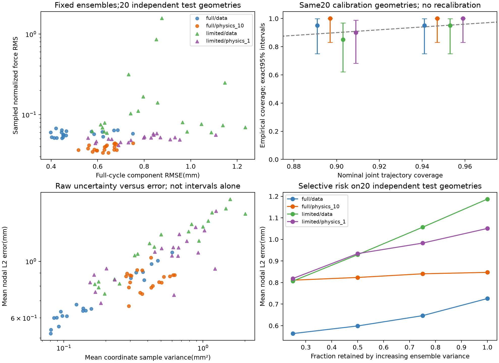

**Post-hoc representation diagnosis, not model selection.** Already evaluated test fields are projected onto the exact frozen rank12 basis. A convex bounded least-squares oracle also respects the deployed coefficient box. These fitted coefficients are unavailable at deployment and are not physically certified predictions. No rank, bounds, weights, calibration or selected model is changed.

| Regime | Mean span oracle RMSE(mm) | Mean bounded oracle RMSE(mm) |
|---|---:|---:|
| full | 0.04627 | 0.04685 |
| limited | 0.06002 | 0.06011 |

| Frozen ensemble | Oracle fraction of mean geometry MSE |
|---|---:|
| full/data | 0.912% |
| full/physics_10 | 0.618% |
| limited/data | 0.554% |
| limited/physics_1 | 0.665% |

For these20 coarse-reference test cases, over99% of measured MSE lies above the best field attainable in the existing basis/box. This diagnoses learned coefficient prediction, rather than POD truncation/readout bounds, as the dominant model-error contribution. It does not distinguish optimization, recurrent-network capacity and generalization; it does not resolve FE discretization uncertainty.

Actual routing test: g030_l0 rejected before NN execution and sent to an independent full FE trajectory; fresh-cache flagTrue, observed wall340.7s. This run overlapped cohort generation and is not an isolated latency benchmark. Inputs were geometry/loading descriptors and zero initial histories only.

**Full-cycle reference numerical uncertainty.** Exact consistent-mass volume-L2 comparisons use200 common endpoints0.005–1.0s on the baseline geometry. A separately verified history continuation adds the exact1s endpoint without changing the archived999 frames.

| Timestep | Space-time volume-L2 discrepancy vs1ms | Volume/time component RMSE(µm) |
|---|---:|---:|
| dt005 | 1.6262% | 139.602 |
| dt0025 | 0.3497% | 30.022 |

The5ms model task misses the preregistered1% temporal tolerance;2.5ms is below that tolerance relative to1ms. Refinement reduces the discrepancy, but1ms is not continuum truth and unequal timestep ratios do not establish an asymptotic rate. The reported NN error remains relative to the5ms discrete target.

Spatial full-cycle comparison at2.5ms: 17625 to141000 tetrahedra, identical polyhedral domain/material/BC and the same interpolated continuous fiber fields. Space-time volume-L2 difference13.119%; volume/time component RMSE1263.707µm. Within1% tolerance:False. Two levels quantify spatial sensitivity; they do not establish asymptotic mesh convergence.

These FE discrepancies are from one baseline geometry/waveform and use volume-weighted norms; model tables use uniform nodal norms on other geometries. They cannot be added as independent random variances or used to claim continuum coverage. Finer held-out reference trajectories would be required to calibrate error against a mesh-independent target.

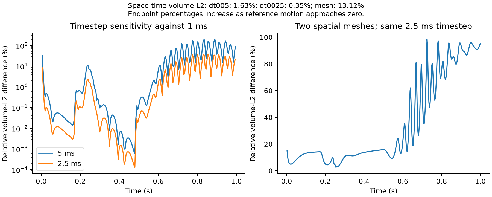

**Reference refinement capacity.** A bounded engineering probe on the third linear mesh (1128000 tetrahedra, 639735 displacement DOFs) used sampled peak RSS 8.25GiB. One1000Pa startup query converged:True, nonlinear solve155.01s. This is not a full trajectory or a convergence result.

A quadratic-displacement capacity probe on the baseline mesh (89679 DOFs) used 1.33GiB and31.80s for the same startup query, including first-use compilation. It is not a matched speedup measurement. The pinned source defaults to P2 displacement; the neural corpus uses P1 displacement. The follow-up retains the same P1 fiber fields and passive mechanics while changing discretization. A strong bulk penalty makes volumetric locking a possible contributor, but this is not an isolated causal diagnosis.

**Rejected quadratic2.5ms trajectory.** 110 steps were accepted before step111 at0.2775s failed withDIVERGED_MAX_IT after100 Newton iterations; residual0.286541N. No failed state was accepted or used for training/calibration. Bounded trust-region and previous-state backtracking retries also failed.

Two1.25ms substeps across that interval accepted:True. This changes the discrete time problem; it does not validate the rejected2.5ms root or complete the trajectory. It motivates a separate800-step1.25ms reference from rest, without patching the failed run or changing frozen neural models.

A separate history/load homotopy reproduced the previous native equilibrium, then attempted the EXACT failed2.5ms algebraic target with ten continuation stages and at most ten Newton iterations per stage. Target recovered:False; last fraction0.40, residual0.0325689N. Intermediate continuation equations are not physical timesteps or surrogate labels. The original accepted checkpoint remains unchanged.

**Controlled P2 time sensitivity.** Only the time discretization changes; passive mechanics, initial conditions, geometry and loading remain fixed. Compared 200 common endpoints through 1s. Space-time volume-L2 discrepancy 0.0459%; component volume/time RMSE 0.00491mm. Within the declared1% tolerance: True. Exact consistent-mass norms passed independent native interpolation/UFL checks at four fixed frames. Time integration uses a trapezoid including the exactly zero initial fields. This is two-level sensitivity on one case, not an asymptotic convergence rate or continuum certification.

**Controlled P2 mesh workflow stopped:** generation failed with return code 1; see preserved log. Last recorded phase generation. Existing accepted checkpoints remain available; no completed validation claim follows.

**Controlled P2 mesh (GMRES/GAMG) workflow stopped:** generation failed with return code 1; see preserved log. Last recorded phase generation. Existing accepted checkpoints remain available; no completed validation claim follows.

**Controlled P2 quadrature sensitivity.** Only the quadrature discretization changes; passive mechanics, initial conditions, geometry and loading remain fixed. Compared 800 common endpoints through 1s. Space-time volume-L2 discrepancy 1.5680%; component volume/time RMSE 0.16767mm. Within the declared1% tolerance: False. Exact consistent-mass norms passed independent native interpolation/UFL checks at four fixed frames. Time integration uses a trapezoid including the exactly zero initial fields. This is two-level sensitivity on one case, not an asymptotic convergence rate or continuum certification.

**Controlled P2 quadrature degree8/10 refinement in progress:** 430/800 accepted native steps. Full-cycle comparison and its independent norm checks remain pending. Frozen neural models and calibration remain unchanged.

**Refined iterative solver failure retained.** Native GAMG/SNES stopped at0.270s after215 accepted states (210 persisted). Native log reports linear-solve divergence: True; SNES reason-3. The underlying Krylov/preconditioner cause was not recorded and remains unresolved. Across210 common persisted states through0.2625s, direct/iterative maximum relative coefficient discrepancy was1.06e-09, with maximum absolute discrepancy1.19e-13m. This is partial solver agreement, not full-cycle equivalence or a successful mesh-convergence check. Rejected iterative data are preserved and have not been restarted; the direct control status is reported separately.

**Refined direct reference rejected.** MUMPS/SNES stopped at0.270s with positive reason3, but residual0.000146716N exceeded the unchanged1e-6N acceptance criterion. A positive relative-convergence flag alone is insufficient. The failed state was not accepted; the original reference remains stopped. A separate six-step,1800s engineering probe starts at its immutable210-step checkpoint, disables relative stopping and requires1e-8N absolute nonlinear tolerance. This changes solver stopping only, without changing mechanics or relaxing physical acceptance. Recovery would not establish full-cycle mesh convergence.

Strict-stopping engineering probe: completed False, accepted 4/6 requested steps; all accepted False. Failure if recorded: native exception; full details retained in metric. Original reference arrays remain unchanged.

**Bounded refined timestep diagnostic.** The strict1.25ms stopping probe accepted four steps through0.2675s, then terminated at the1800s solve-budget boundary while attempting0.26875s (PETSc wrapped the Python monitor exception). It did not reach the original rejected0.270s target. A separately fixed diagnostic attempts fourteen0.625ms steps from the original immutable0.2625s checkpoint through0.27125s, with strict absolute stopping and unchanged physical acceptance. It changes time discretization and inherits the old history; it is not a recovered1.25ms root or a full-cycle convergence result. No accepted trajectory is overwritten.

Half-step probe: finished True, accepted 9/14 steps, all requested accepted False.

**Half-step budget extension.** The first0.625ms probe accepted nine steps through0.268125s, then its total solve-budget guard fired at1840.9s during the0.26875s attempt. No nonlinear-convergence conclusion follows for that unfinished attempt. A separately fixed5400s extension repeats the same fourteen steps and physical acceptance. The earlier probe saved residual diagnostics but no displacement histories, requiring repeated computation; the extension now saves each accepted displacement and an atomic separate history checkpoint. Original references and earlier probe records remain unchanged. No full-cycle claim follows.

Extended half-step probe: finished True, accepted 14/14, all requested accepted True, budget exhausted False.

**Verified local half-step recovery.** All14 steps through0.27125s accepted; independent verification passed True. Maximum independently reassembled native residual 4.97e-09N. Minimum whole-element endpoint/stress Bernstein bounds 0.084064/0.108821; no unresolved elements at1e-9 float64 margin. Four independent canonical-quadrature/UFL norm checks have maximum relative discrepancy 1.05e-14. Field/input/checkpoint hashes are recorded. This crosses the difficult interval on a changed time grid with inherited histories; it does not recover the rejected1.25ms algebraic problem or establish full-cycle convergence.

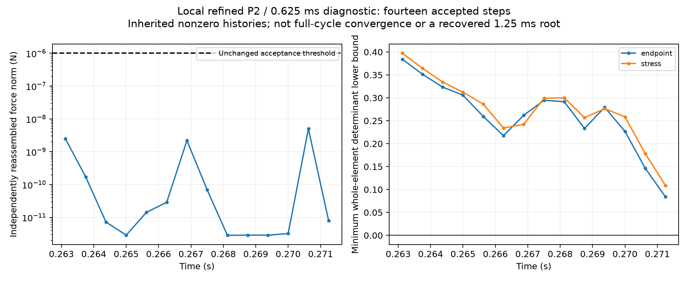

Faster-backend qualification on three fixed accepted half-step states: probe complete False, same-root accepted 0/3. A refined full-cycle GAMG run requires all three probes to pass. These bounded same-history probes do not establish recursive solver equivalence or isolated speedup.

**Prospective full-cycle half-step references.** Separate coarse/fine P2/Q6/GAMG protocols use0.625ms,1600 steps from rest, strict1e-8N absolute/zero-relative nonlinear stopping and unchanged physical acceptance. Coarse generation begins first; refined generation is gated on the local faster-backend probes and a completed coarse reference. Their matched mesh comparison remains pending. Q6 integration sensitivity is still unresolved; these runs are numerical diagnosis, not automatically qualified teacher data or continuum truth.

**Independent geometry/loading numerical controls.** Two existing validation geometries and their distinct fixed pressure histories are prescribed before generating higher-order labels. Each uses P2/1.25ms/GAMG from rest on both mesh levels, preserving its own continuous P1 fibers and domain. These are numerical-validation cases; calibration/test outcomes do not select the references or models. Geometry-dependent P2 DOF/component correspondence and refined connectivity must be verified during future cohort preprocessing.

| Validation input | Coarse/fine persisted steps | Full-cycle relative volume L2 difference | Within1% |
|---|---|---:|---|
| g004_l0 | 800/800; 360/800 | pending | pending |
| g005_l1 | 800/800; 210/800; rejected nonconvergence_or_invalid_force_or_field | pending | pending |

**P2 correspondence audit (inputs only).** All4 geometry/mesh-level pairs have bijectively matching displacement coordinates and physical components after undoing the exact affine scale (tolerance1e-12m). Coarse connectivity matches after vertex permutation; refined connectivity differs on both validation geometries. Shared displacement-coefficient representation therefore requires explicit per-case DOF permutation; mechanics/graph operators must retain each case's own elements. No displacement labels or calibration/test outcomes were read. This checks these inputs, not arbitrary future geometries or numerical convergence.

**Completed coarse P2 validation reference g004_l0.** All800 native steps converged; maximum residual 9.9e-09N. Output hashes verified. Minimum whole-element Bernstein bounds at endpoint/stress states: 0.402018/0.401928, using the float64 sufficient-condition audit described below. Independent canonical P2 quadrature and native UFL displacement norms agree at four fixed frames (largest relative discrepancy 6.66e-15). This verifies the completed calculation; its refined-mesh sensitivity test remains separate.

**Completed coarse P2 validation reference g005_l1.** All800 native steps converged; maximum residual 1.17e-08N. Output hashes verified. Minimum whole-element Bernstein bounds at endpoint/stress states: 0.365006/0.367751, using the float64 sufficient-condition audit described below. Independent canonical P2 quadrature and native UFL displacement norms agree at four fixed frames (largest relative discrepancy 5.09e-15). This verifies the completed calculation; its refined-mesh sensitivity test remains separate.

Run `make dynamic-quadratic-validation-g004` and `make dynamic-quadratic-validation-g005` after native setup. A completed numerical control can still fail the sensitivity tolerance. The original frozen20-member model comparison remains separate.

**Integration control.** Nonpolynomial HGO stress also requires a quadrature check independent of operator agreement. `make dynamic-quadratic-quadrature` compares full degree6 and degree8 trajectories at the same P2 mesh,1.25ms timestep, solver, loading and initial state. The same1% displacement-sensitivity criterion is applied; no native quadrature setting is lowered to make the check pass.

**Refined P2 resource probe:** 639735 displacement DOFs; single1000Pa startup query accepted True, residual 8.95821e-12N, nonlinear solve 180.37s, sampled peak worker memory 10.68GB. This bounded engineering query does not establish full-cycle feasibility or convergence. The matched mesh-refinement trajectory uses fixed1.25ms steps and a20,000MB MUMPS allocation cap.

**Controlled polynomial-order sensitivity at fixed1ms.** P1 and P2 share the same17625-tetrahedron polyhedral domain, continuous P1 fiber fields, passive law, pressure waveform and zero initial histories. All1000 times and pressures match; the original999 P1 frames remain immutable and a separately verified native continuation supplies the exact1s endpoint. Only displacement degree changes. Space-time volume-L2 difference 24.1773%; volume/time component RMSE 2.59026mm. Within1%: False.

The exact P1-to-P2 transfer and consistent mass norms passed independent native interpolation/UFL integration at four frames (maximum relative discrepancy 4.54e-15); archived P1 histories reproduce the current native weak residual below1e-6N at those frames. This isolates displacement-order sensitivity on one known case and does not identify locking as its proven cause, establish an asymptotic p-convergence rate or make P2 continuum truth. No model or calibration is refitted.

A qualified higher-order teacher will require a matching displacement representation and physics residual. Feeding only P2 vertex labels into the existing P1 residual would not verify higher-order mechanics. Finer-reference retraining and independent calibration must follow a separately frozen protocol after numerical qualification.

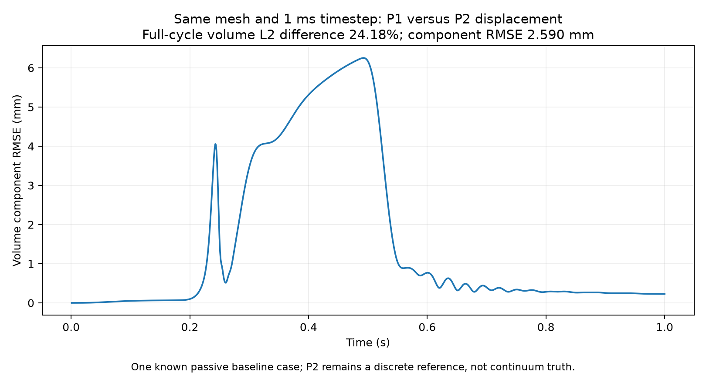

**Standalone differentiable P2 mechanics verification.** Passed: True. Three fixed positive-stress-J trial fields use startup and deformed nonzero histories from the known baseline case. The new flat native-DOF operator assembles source HGO elasticity, viscosity, quadratic consistent inertia, quadratic Robin terms and follower pressure evaluated at facet quadrature. Fibers and reference geometry remain P1. All density, Robin and time-scheme constants are exported from the native problem.

| Precision/device | Largest force relative error | Largest loss-gradient relative error | All3 passed |
|---|---:|---:|---|
| cpu32 | 0.00197193 | 0.00478301 | True |
| cpu64 | 3.01309e-11 | 8.87459e-11 | True |
| mps32 | 0.00200208 | 0.00482936 | True |

CPU64 tangent actions agree with native UFL at relative error at most 2.59e-13; analytic Piola agrees with energy autodiff at 1.74e-13. Coupled displacement/history directional derivatives agree with centered native force differences at 4.6e-08. Thresholds fixed before verification:1e-7 for CPU64 force/tangent/gradient/Piola,1e-4 for native history differences and1% for float32 force/gradient. Precision results apply to these perturbed fields, not uniformly near vanishing equilibrium residuals. Current neural weights and calibration remain frozen. A trained P2-neural directional-gradient check remains required before any higher-order physics-loss claim. Reproduce with `make quadratic-backend-verify`.

**Iterative linear-solver engineering check.** Identical native Newton tangent matrices and right-hand sides are solved with MUMPS and GMRES/GAMG. Six rigid-body modes supply the near-nullspace. The previous accepted reference fields independently verify reconstructed histories. This does not replace any reference trajectory or alter its mechanics. Timings overlap other FE calculations and are engineering measurements, not isolated end-to-end speedups.

| Reference | Time(s) | MUMPS(s) | GMRES/GAMG(s) | Linear correction relative difference | GAMG accepted |
|---|---:|---:|---:|---:|---|
| cardiac_quadratic_reference_dt00125_v1 | 0.00125 | 1.693 | 1.376 | 1.53e-09 | True |
| cardiac_quadratic_reference_dt00125_v1 | 0.28 | 1.712 | 2.862 | 1.12e-09 | True |
| cardiac_quadratic_reference_dt00125_v1 | 0.5 | 2.076 | 1.827 | 3.91e-11 | True |
| cardiac_quadratic_reference_refined_v1 | 0.00125 | 42.191 | 14.004 | 1.6e-09 | True |

Acceptance requires positive KSP reason, finite correction and true linear residual below1e-8N. Full nonlinear convergence, refined-mesh loaded-state robustness and complete-cycle equivalence must be verified before changing the trajectory solver. Startup agreement alone cannot justify such a change.

**Native nonlinear iterative-solver verification.** Frozen histories and prescribed pressure reproduce each accepted MUMPS state before an independent GMRES/GAMG solve from the production predictor. Effective KSP and PC types and Jacobian near-nullspace attachment are checked. All physical equations, displacement space and reference data remain unchanged.

| Reference | Time(s) | GMRES/GAMG nonlinear(s) | Native residual(N) | Relative coefficient difference vs MUMPS | Accepted same root |
|---|---:|---:|---:|---:|---|
| cardiac_quadratic_reference_dt00125_v1 | 0.00125 | 6.468 | 9.13173e-13 | 1.00696e-09 | True |
| cardiac_quadratic_reference_dt00125_v1 | 0.28 | 31.062 | 2.81062e-10 | 6.39829e-15 | True |
| cardiac_quadratic_reference_dt00125_v1 | 0.5 | 5.322 | 1.19126e-11 | 3.83358e-15 | True |
| cardiac_quadratic_reference_refined_v1 | 0.00125 | 54.998 | 1.11101e-12 | 1.06149e-09 | True |
| cardiac_quadratic_reference_refined_v1 | 0.0875 | 19.153 | 1.29544e-12 | 1.59848e-13 | True |

Probe acceptance requires a positive SNES reason, native residual below1e-6N, positive sampled endpoint/stress determinants and relative coefficient agreement below1e-6 with the accepted direct root. The probes use at most20 Newton iterations with a300s monitor guard at nonlinear iteration boundaries. These fixed-history checks do not establish error accumulation, complete-cycle equivalence, loaded refined-mesh robustness or isolated runtime speedup. The production reference solver is unchanged.

**Full-cycle iterative/direct solver agreement.** Both800-step trajectories start from rest and recursively update their own histories. Geometry, DOF maps, forcing and discretization are byte-identical. Maximum per-frame relative coefficient difference 1.00696e-09; maximum absolute coefficient difference 8.05658e-14m. Passed the predeclared1e-6 relative AND1nm absolute tolerances: True. This controls solver-induced accumulation on one known baseline case; it does not validate discretization accuracy, independent geometries or loaded refined-mesh robustness.

**Refined backend control.** A distinct GMRES/GAMG trajectory starts from rest at the same P2/1.25ms resolution as the direct refined reference. Both direct and iterative trajectories remain separate. Coarse/fine GAMG comparison changes only the mesh; the original direct mesh comparison remains recorded. After BOTH refined trajectories complete, `make dynamic-quadratic-refined-solver-check` verifies full-cycle agreement before any refined solver-equivalence claim. Coarse equivalence and early refined probes alone do not establish this result.

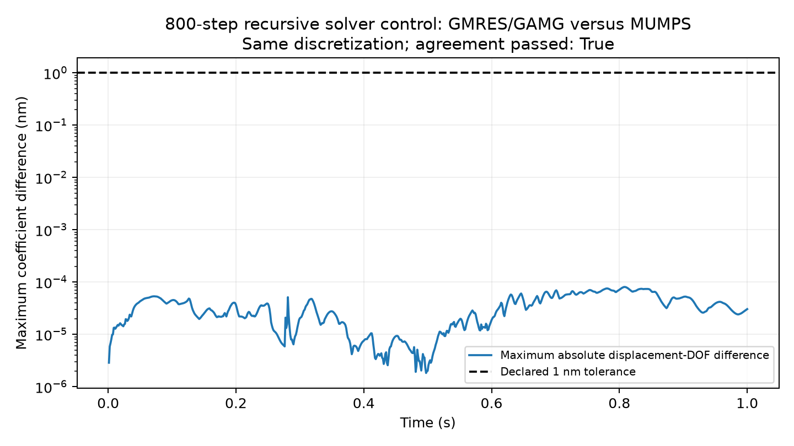

**Whole-element P2 positivity audit (cardiac_quadratic_reference_dt00125_v1).** 800 endpoint and stress-state fields, 17625 tetrahedra each. Minimum cubic Bernstein lower bounds: endpoint 0.230261, stress 0.243632; unresolved element-states 0/0. Sufficient whole-element positivity condition passed: True. A P2 deformation gradient is affine and its determinant is cubic; nonnegative tetrahedral Bernstein basis functions partition unity. Thus positive coefficients bound the determinant throughout each element in exact arithmetic. This implementation uses float64 with1e-9 margin and checks polynomial reconstruction and integral identities at four frames; it is not an interval-arithmetic proof or evidence of discretization accuracy.

**Whole-element P2 positivity audit (cardiac_quadratic_reference_dt001_v1).** 1000 endpoint and stress-state fields, 17625 tetrahedra each. Minimum cubic Bernstein lower bounds: endpoint 0.232228, stress 0.239474; unresolved element-states 0/0. Sufficient whole-element positivity condition passed: True. A P2 deformation gradient is affine and its determinant is cubic; nonnegative tetrahedral Bernstein basis functions partition unity. Thus positive coefficients bound the determinant throughout each element in exact arithmetic. This implementation uses float64 with1e-9 margin and checks polynomial reconstruction and integral identities at four frames; it is not an interval-arithmetic proof or evidence of discretization accuracy.

**Whole-element P2 positivity audit (cardiac_quadratic_reference_gamg_v1).** 800 endpoint and stress-state fields, 17625 tetrahedra each. Minimum cubic Bernstein lower bounds: endpoint 0.230261, stress 0.243632; unresolved element-states 0/0. Sufficient whole-element positivity condition passed: True. A P2 deformation gradient is affine and its determinant is cubic; nonnegative tetrahedral Bernstein basis functions partition unity. Thus positive coefficients bound the determinant throughout each element in exact arithmetic. This implementation uses float64 with1e-9 margin and checks polynomial reconstruction and integral identities at four frames; it is not an interval-arithmetic proof or evidence of discretization accuracy.

**Whole-element P2 positivity audit (cardiac_quadratic_reference_quadrature8_v1).** 800 endpoint and stress-state fields, 17625 tetrahedra each. Minimum cubic Bernstein lower bounds: endpoint 0.312535, stress 0.312547; unresolved element-states 0/0. Sufficient whole-element positivity condition passed: True. A P2 deformation gradient is affine and its determinant is cubic; nonnegative tetrahedral Bernstein basis functions partition unity. Thus positive coefficients bound the determinant throughout each element in exact arithmetic. This implementation uses float64 with1e-9 margin and checks polynomial reconstruction and integral identities at four frames; it is not an interval-arithmetic proof or evidence of discretization accuracy.

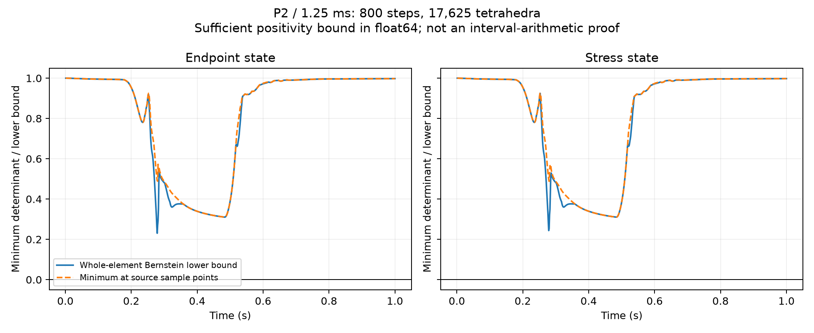

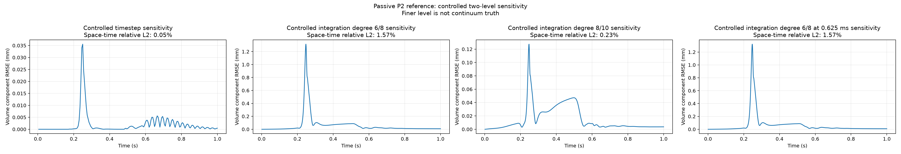

**Full-cycle quadratic-reference sensitivity.** Same baseline geometry/loading and zero initial histories; 800 P2 steps at1.25ms, compared against linear fields at2.5ms on400 common endpoints. Unequal timesteps change BOTH temporal discretization and element order. All native solves require positive SNES reason and residual<1e-6N. Jacobians are sampled at every source quadrature point and every tetrahedral vertex, at endpoint and stress states; positivity between sample locations is not guaranteed.

| Linear comparison | Space-time volume-L2 discrepancy relative to P2 | Volume/time component RMSE(µm) | Within1% |
|---|---:|---:|---|
| coarse_P1 | 24.194% | 2592.176 | False |
| refined_P1 | 12.757% | 1366.810 | False |

Exact mixed-space mass/cross-mass norms passed independent native interpolation/integration at four fixed frames; maximum relative discrepancy3.07e-14. This is a combined discretization sensitivity comparison on one passive case. P2 is not assumed continuum truth. There is no asymptotic higher-order mesh/timestep convergence or revised neural-calibration claim.

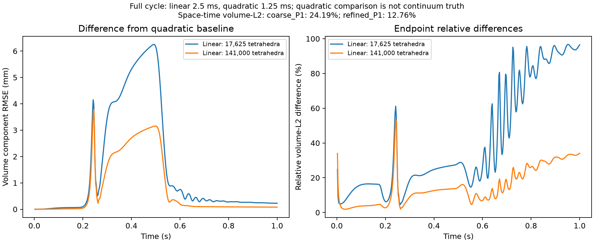

**Fixed-model reference sensitivity, one baseline case.** All20 original frozen checkpoint hashes are rechecked. The same200 prediction endpoints are compared against original P1/5ms and quadratic P2/1.25ms labels on the same4577 vertices. This changes both element order and timestep; it is not a one-factor causal study or a new population test. No model, calibration radius or method choice is refitted.

The two FE targets differ by2.5219mm in nodal component RMSE. This deterministic one-case discrepancy cannot be added as an independent random variance to model error.

| Frozen ensemble | RMSE vs P1/5ms(mm) | RMSE vs changed P2 reference(mm) |
|---|---:|---:|
| full/data | 0.41457 | 2.43001 |
| full/physics_10 | 0.56135 | 2.70018 |
| limited/data | 0.70543 | 2.32411 |
| limited/physics_1 | 0.56142 | 2.55193 |

The original nominal95% balls miss the changed reference for4/4 ensembles on this single case, although they contain its original coarse-reference field. This is not a population coverage estimate. Input-support checking does not quantify this numerical-reference uncertainty; an FE fallback also inherits its chosen discretization. P2 remains a discrete comparison, not continuum truth; this case is not added to the20 independent primary/confirmation test geometries.

**Matched original-timestep stability check.** A separate one-geometry/one-cycle, seed11 pilot uses the archived1ms pressure/reference trajectory. Train first600 frames, select on the next200, evaluate the already-inspected last199. This is a repeated temporal benchmark, not independent trajectory confirmation. Every999-step inference begins at zero and uses only prescribed pressure and its own predicted histories. A training-only15% relative field-RMSE gate excludes the trivial zero predictor; the initial version that selected zeros on low-motion validation is retained as a FAILED acceptance test, not a stability success.

| Original1ms model | Whole-cycle RMSE(mm) | Late test-block RMSE(mm) | Training relative RMSE | Endpoint min detF | Stress-state min detF | Nontrivial/complete999 |
|---|---:|---:|---:|---:|---:|---|
| data | 0.690053 | 0.867479 | 4.114% | 0.48262 | 0.48251 | True |
| physics_10 | 0.699836 | 0.720765 | 5.952% | 0.57489 | 0.57501 | True |

The late reference displacement RMS is only about0.079mm; late prediction errors are much larger than that signal. The result demonstrates stable, nontrivial full-cycle rollout at the ORIGINAL1ms timestep, but does not establish accurate long-horizon extrapolation. Architecture, representation and training changed together; no single-factor causal attribution is made. No population CI or temporal conformal claim is supported by one cycle.

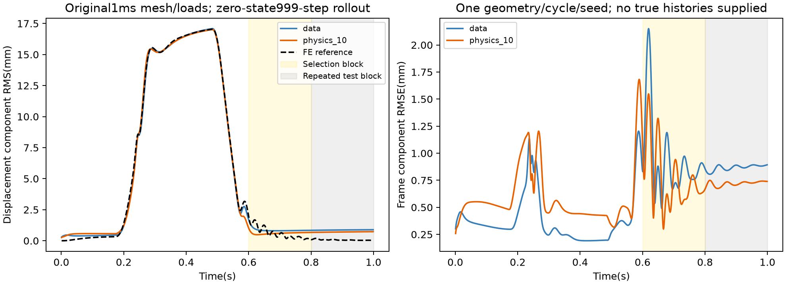

All-cell stress-state positivity audit: 80 complete ensemble trajectories across20 test geometries, all200 generalized-alpha states; minimum detF0.491746, passed:True. Endpoint positivity was checked separately. Positive determinants alone do not establish accurate mechanics.

**Matched full-cycle runtime.** Preferredfull/physics_10, CPU float64, two threads, same held-out geometry/loading and200-step task. Five-member full displacement mean plus coordinate variance: median256.28ms resident, 248.22ms with warm input reads/pooling, 1553.25ms with all-element endpoint/stress-state J checks. Matched FE nonlinear solves total median197.07s (793.9× against NN with preprocessing). Two fresh FE cycles were timed; NN repeats30/20/10 for these three scopes. Full-process FE setup/generation/IO/audit wall is separate. No speedup applies to rejected requests; no Dalton,1ms or clinical speedup is inferred.

| Frozen ensemble | Resident mean/variance(ms) | With input processing(ms) | With endpoint/stress-state checks(ms) |
|---|---:|---:|---:|
| full/physics_10 | 256.28 | 248.22 | 1553.25 |
| full/data | 253.20 | 252.09 | 1563.36 |
| limited/data | 257.53 | 254.07 | 1577.17 |
| limited/physics_1 | 252.38 | 248.74 | 1562.92 |

Exact frozen-artifact bundle: `experiments/checkpoints/dynamic_frozen_bundle.tar.gz`, 17.86MB, 20 selected checkpoint files. Archived-member checksum roundtrip passed:True. Weights, train-only preprocessing, graph hierarchy, model source, attribution, configs and frozen evaluation are included; the FE corpus and environment are separate. Full archive/member SHA256 values are in experiments/manifests/dynamic_replay_bundle.json. The archive is local/ignored, not uploaded; `make dynamic-bundle` exports it.

**Reproduction.** After original solver/data setup, use `make dynamic-study` in this cached workspace. A clean checkout contains recorded metrics but omits checkpoints: use the exact local bundle to retain the evaluated weights, or `make dynamic-reproduce` to retrain missing weights and explicitly label the same-case replay as repeated benchmark reproduction. Use `make dynamic-benchmark` for recorded isolated timings; reproduction forces fresh timing queries. Controlled quadratic refinement uses `make dynamic-quadratic-time` and `make dynamic-quadratic-mesh`; these resume matching checkpoints, verify native mass norms, audit whole-element positivity and update this report after completion or failure. `make dynamic-quadratic-positivity` audits the existing800-step reference. `make dynamic-quadratic-order-control` isolates polynomial order at1ms. `make dynamic-quadratic-solver` and `make dynamic-quadratic-mesh-gamg` execute the distinct iterative controls; `make dynamic-quadratic-refined-solver-check` requires both completed refined references. Configs define every geometry, waveform, seed and split; large arrays/checkpoints/logs and local workflow progress remain ignored. The existing report is the only results Markdown. No paper directory or manuscript is created.

**Executed extension studies (2026-10-16).** The experiments below are separate from the earlier pilots. Negative and failed outcomes are retained. The full research claim of robust autonomous prediction across shapes and trajectories is not established.

**Dalton architecture study and updated five-seed ensemble.** All2250 original training geometries; selection remains validation0:16. Three seed11 candidates share the160-epoch maximum schedule; early stopping can shorten actual runs. This screens candidate designs, not a population-level architecture ranking.

| Candidate | Graph nodes | Parameters | Best selection RMSE(cm) | Epochs completed |
|---|---:|---:|---:|---:|
| control_v4 | 106 | 138563 | 0.068385 | 141 |
| capacity_v4 | 106 | 665091 | 0.085062 | 160 |
| fine_graph_v4 | 848 | 138563 | 0.079712 | 141 |

Selected control_v4, then trained all five seeds. Same503 previously inspected test geometries: mean nodal L2 error 0.065169cm versus 0.065840cm for the previous ensemble (1.02% lower). Released-model reference remains0.041416cm. Paired mean change -0.000671385cm, conditional geometry-bootstrap95% interval [-0.0013095797621645033, -8.012990183488018e-05]. This is a repeated benchmark comparison, not a new confirmatory test. The accuracy gap to the released model remains.

Updated uncertainty/error Spearman correlation 0.8961. Historical calibration134 is reused without coverage-based selection. Nominal90/95% joint-geometry coverage: 471/503 (93.64%), radius0.4025cm, 480/503 (95.43%), radius0.4541cm.

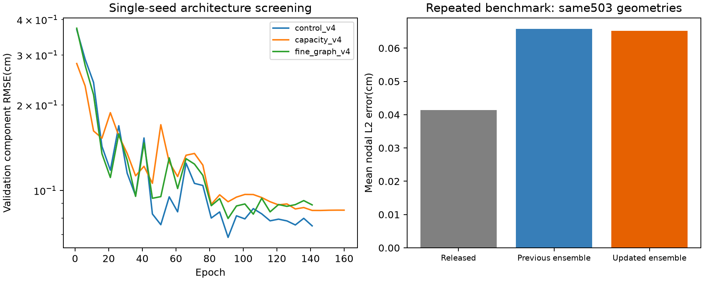

**New mechanics-complete numerical geometry cohort.** 64 independent uniform parameter draws within±5% of the documented ellipsoid radii, plus4 predeclared±10% extrapolation corners. This is a controlled numerical shape distribution from ONE benchmark family, not an anatomical or physiological population. The long axis is X as verified in the source. The original source microstructure algorithm is rerun on every scaled geometry. Exact affine nodal correspondence and unchanged tetrahedral indices are verified.

272 startup simulations converged on 68 geometries, four prescribed loads each, dt1ms, zero histories/activation. All4577 nodes and17625 tetrahedra retained. Minimum reference endpoint detF 0.964086; zero inversions; maximum normalized reference force RMS 1.02e-11; no exact duplicate parameter draws. Small perturbations deliberately create closely related shapes.

Geometry splits:20 training(80 loads),8 selection(32),20 calibration(80),16 test(64),4 extrapolation(16). Every load from a geometry stays in its split. This cohort has no historical calibration/test reuse. Train-only normalizers and rank12 POD use only the80 training fields. The graph encoder has64 pooled nodes, width32 and two message-passing rounds; a geometry/load-conditioned neural head predicts POD coefficients. Correspondence is specific to this affine family.

Five matched seeds,800 optimizer updates per model. Physics lambda screened at1/100 on seed11, then frozen at 1 using trusted float64 validation residuals subject to a10% displacement-RMSE constraint. Optimization/checkpoint scoring used the verified float32 GPU residual; final evaluation uses float64 arithmetic and trusted FE assembly. The CPU pilot and interrupted screening arm are preserved in cpu_geometry_pilot.json.

| Five-member ensemble | Mean geometry component RMSE(µm) | Mean normalized force RMS | Mean element strain error | Mean relative elastic-energy error |
|---|---:|---:|---:|---:|
| data | 0.256068 | 0.00016867885 | 6.82669e-05 | 0.0160336 |
| physics_lambda1 | 0.256391 | 0.00016888652 | 6.83458e-05 | 0.0160697 |

H1 is not supported in this startup study. Physics/data displacement-RMSE ratio 1.001262; paired mean normalized residual difference(physics minus data) 2.0767e-07, conditional geometry-bootstrap95% interval [3.305252562804678e-08, 3.5890349685049275e-07]. The approximately0.12% residual difference is small; it does not show a useful physics benefit. Bootstrap intervals condition on trained models and exclude retraining/implementation uncertainty. Individual matched-seed outcomes are in the JSON.

**Natural-boundary ablation.** All DOFs are free. Interior and boundary-DOF contributions partition the SAME full assembled weak residual, including inertia, viscosity, Robin terms and follower pressure; their losses sum exactly when normalized by total DOFs. Boundary-DOF loss is not a claim that external traction alone should vanish. Ablations use one matched seed only.

| Seed11 residual-loss region | Test component RMSE(µm) | Mean normalized FULL residual RMS |
|---|---:|---:|
| interior | 0.227562 | 0.00015266148 |
| boundary | 0.227851 | 0.00015292558 |

**Independent geometry calibration.** The simultaneous score is the maximum nodal L2 displacement error over ALL nodes AND ALL four loads in a geometry. Corrected split-conformal quantiles use20 calibration geometries. Exchangeability refers only to the defined uniform numerical parameter distribution.

| Ensemble | Nominal | Joint test coverage | Radius(µm) | Exact binomial95% interval |
|---|---:|---:|---:|---|
| data | 90% | 15/16 (93.75%) | 2.8578 | [0.6976792615654681, 0.998418888277234] |
| data | 95% | 16/16 (100.00%) | 3.4575 | [0.7940927857921773, 1.0] |
| physics_lambda1 | 90% | 15/16 (93.75%) | 2.8592 | [0.6976792615654681, 0.998418888277234] |
| physics_lambda1 | 95% | 16/16 (100.00%) | 3.4581 | [0.7940927857921773, 1.0] |

The16 test geometries give wide coverage intervals. Raw variance/error Spearman correlation was0.75 for both ensembles; selective-risk results are in the per-model JSON. This does not make raw variance a calibrated interval.

**Observed shift failure:** both nominal90% and95% balls covered0/4 extrapolation geometries for both models. Mean nodal error increased from about0.35µm in distribution to3.64µm at the shifted corners. The four deterministic corners have no exchangeability-based coverage guarantee and do not support a population-level shift estimate. H3 is not supported.

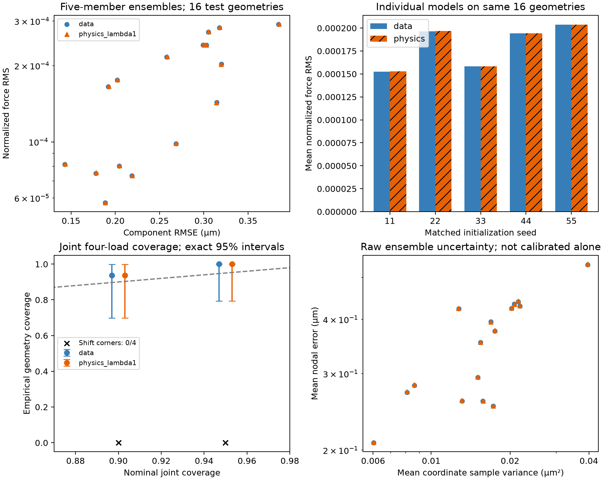

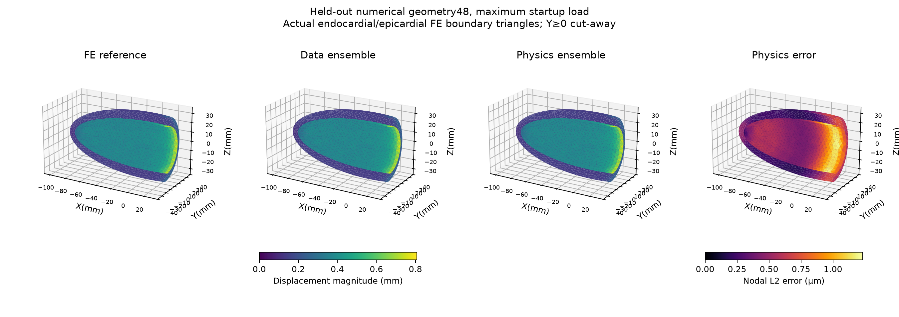

**Controlled refinement and fresh confirmation cohort.** The earlier v2 test remains reported above. Each of five original data-trained checkpoints now initializes BOTH matched refinement arms. Each arm receives400 updates at learning rate1e-4 to1e-5. Physics uses four mixed geometry/load cases per update; a training-only gradient diagnostic registered lambda100/1000/10000. Original training20/selection8 geometries are reused; no new target affects training or selection.

Validation selected lambda100 under the predeclared10% displacement constraint. This selects a physics candidate even if data-only has a lower validation residual; it does not itself demonstrate an advantage. All five models were frozen before evaluation. Fresh seed271828 supplies20 calibration and16 test geometries within the same numerical±5% distribution. Another16 random draws lie outside that support in the±5–10% corner regions. Original training-only POD, pooling and normalizers are reused without refitting. These are new numerical geometries, not independent anatomical sources.

All208 additional FE solves converged; minimum endpoint detF0.964567, no inversions, maximum reference force RMS9.82e-12.

| Refined five-member ensemble | Fresh test RMSE(µm) | Normalized force RMS | Mean nodal L2(µm) |
|---|---:|---:|---:|
| data | 0.210079 | 0.00013249044 | 0.292581 |
| physics_lambda100 | 0.216911 | 0.00013563106 | 0.301911 |

Physics/data RMSE ratio1.032523; paired force-RMS difference3.14062e-06, conditional geometry-bootstrap95% interval[2.1356860408155457e-06, 4.148290824321959e-06]. Descriptive H1 criterion satisfied:False. This criterion requires a lower mean residual and no more than10% RMSE degradation; it is not a population-level significance test. Geometry bootstrap conditions on five fitted members; matched individual-seed results are retained in the JSON.

| Refined ensemble | Nominal | Fresh joint test coverage | Radius(µm) | Shift coverage |
|---|---:|---:|---:|---:|
| data | 90% | 16/16 | 2.2773 | 0/16 |
| data | 95% | 16/16 | 2.6691 | 0/16 |
| physics_lambda100 | 90% | 16/16 | 2.2999 | 0/16 |
| physics_lambda100 | 95% | 16/16 | 2.8037 | 0/16 |

Coverage refers jointly to all4577 nodes and all four startup loads in a geometry; exact binomial intervals and selective-risk curves are in the evaluation JSON. Only16 test geometries keep inference imprecise. No conformal guarantee extends to the shifted draws.

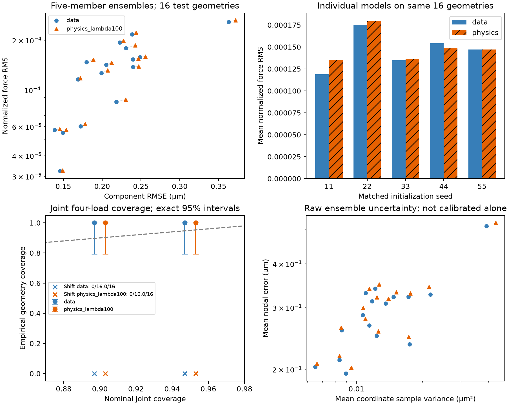

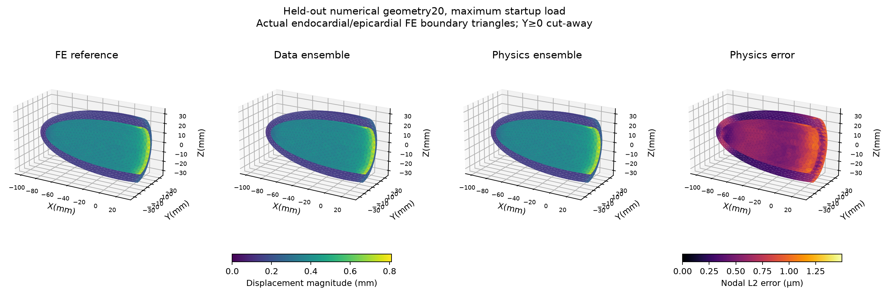

**Full passive reference trajectory and temporal sensitivity.** A pressure-only variant of the pinned dynamic benchmark, with P1 displacement/fibers, zero activation and initial u/v/a=0. Generalized-alpha histories are updated after every converged solve; pressure is evaluated at the source intermediate time. This differs from the default active/P2 benchmark.

999/999 steps completed over0.001–0.999s, dt1ms; minimum endpoint detF 0.629753, zero inverted elements across all stored states. Measured FE trajectory wall time 1477.2s. The40ms endpoint volume-L2 differences versus dt0.5ms were 0.00620% for dt1ms and 0.03329% for dt2ms. This short-interval check does not prove full-cycle timestep convergence. Earlier two-level mesh sensitivity also does not establish mesh independence.

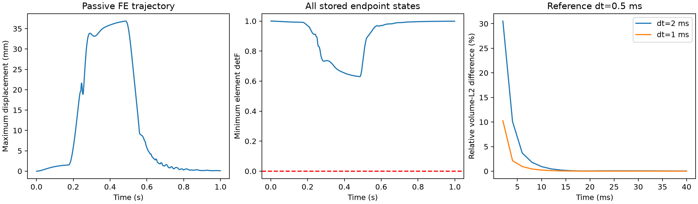

**Temporal neural pilot, with explicit rollout failure.** One fixed geometry and one cycle. Train first600 timesteps, select on next200, evaluate last199. A64/64 MLP with train-only rank16 POD predicts acceleration increments from causal displacement/velocity/acceleration histories and prescribed pressure. Exact Newmark updates produce the displacement prediction. Matched seed11 and400 updates per condition. Time frames are dependent: no geometry/trajectory confidence interval or conformal claim is made.

The original lambda1/100 grid had little effect. A training-only parameter-gradient diagnostic on eight training frames registered the balanced grid1e5/1e6/1e7, then validation selected1e6. The same temporal block had already been evaluated by the original pilot; the balanced comparison is exploratory repeated temporal evaluation. No test outcome selected the grid.

| Model | True-history one-step component RMSE(µm) | Mean normalized force RMS | Recursive valid steps /199 | First invalid-J time(s) |
|---|---:|---:|---:|---:|
| data | 0.242987 | 6.7499844e-05 | 28/199 | 0.8290000000000001 |
| physics_lambda1e+06 | 0.221051 | 5.1236249e-05 | 25/199 | 0.8260000000000001 |

With true histories supplied, balanced physics weighting reduced conditional one-step displacement error by about9.0% and force residual by24.1%. BOTH recursive rollouts failed with inverted elements: physics after25 valid steps and data-only after28. Valid-prefix errors use different horizons and must not be interpreted as successful or directly comparable complete rollouts. The temporal model is not a validated autonomous full-cycle predictor. Scaling to a multi-geometry trajectory cohort is a no-go until closed-loop stability is addressed.

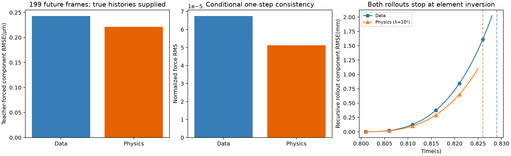

**Matched speed and cost.** CPU float64, two threads, same P1 startup task, four held-out numerical geometries×four loads. Neural inference returns the full4577×3 field.

Warm FE median 998.184ms, five-member mean plus coordinate sample variance median 3.639ms: 274.3× for this startup task. Batch-one repetitions:32 timed FE solves and800 ensemble calls. No full-cycle, Dalton or clinical speedup follows. Including warm input-file reads, graph pooling and normalization, mean/variance inference costs 4.956ms (201.4×). Model load and geometry activation are recorded separately in geometry_runtime.json. Fiber-field generation is excluded from the resident-input inference comparison.

New cohort generation wall time 741.5s; GPU study training/validation grid plus ablations 394.2s. Measured partial-cost recovery about1143 comparable queries. This excludes the CPU pilot, verification, temporal experiments, preprocessing and software setup; it is not whole-project break-even.

Fresh-cohort refinement timing (selected physics-lambda100 five-member ensemble): mean plus variance 3.732ms with resident normalized inputs, or 5.178ms including warm file reads and input processing; matched warm FE 1017.522ms (196.5× including input processing). Same CPU float64/two threads;32 timed FE solves,800 resident ensemble calls,160 input-inclusive calls. Extra cohort generation258.3s and refinement screening/training/validation277.2s. This additional-cost accounting excludes the parent v2 training/corpus and all other research costs. Lower latency does not remedy the negative physics/shift results.

Physics-only backpropagation through an actual trained graph/POD model was verified: parameter-gradient norm 6.29037e-06; relative difference versus native float64 VJP through the same network graph 3.32e-05. Independent assembly checks include nonzero histories and a strongly deformed state. GPU optimization uses float32 after controlled precision checks; final mechanics uses float64.

**Historical go/no-go and reproducibility.** These extension pilots originally left the released-model accuracy gap, study-specific physics outcomes, shift undercoverage and unstable recursive dynamics unresolved. The later full-cycle study above executes closed-loop training and independent trajectory tests; its results supersede that earlier rollout no-go. Independent anatomical sources and full-cycle numerical convergence remain unvalidated. The current reference-refinement experiments and their failures or progress are reported above.

Reproduce the extensions with `make graph-study`, `make geometry-study`, `make temporal-study`, `make geometry-confirmation` and `make report` after the original data/environment setup. Runtime requires the legacy solver environment; MPS training requires Apple GPU access. Configs, split IDs, checkpoint hashes, per-geometry/seed results and failed-rollout artifacts are retained. Large datasets/checkpoints/logs remain ignored.

Official conference requirements were verified and checksummed in experiments/manifests/conference.json: [CMBBE2027 submission page](https://www.cmbbe-symposium.com/2027/abstract-submission/). The mandatory template is one A4 page in two columns, including figures/references; deadline15November2026 at23:59CET. No manuscript or submission was created, respecting the user request to exclude paper/.

Released GNN: 567 held-out geometries, mean nodal L2 error 0.041037 cm.

Original 64-training-case pilot ensemble: mean nodal error 0.479376 cm on test0:64. Independent members were worse than their mean; the pilot gap reflects data, architecture and training-budget differences, not evidence that averaging hurts.

| Model | Main test geometries | Mean nodal L2 (cm) | Mean case component RMSE (cm) |
|---|---:|---:|---:|
| full_gnn_ensemble | 503 | 0.065840 | 0.041815 |
| full_point_baseline | 503 | 0.090279 | 0.056794 |
| full_gnn_seed11 | 503 | 0.097570 | 0.061320 |
| full_gnn_seed22 | 503 | 0.071563 | 0.045292 |
| full_gnn_seed33 | 503 | 0.086597 | 0.054750 |
| full_gnn_seed44 | 503 | 0.071306 | 0.045153 |
| full_gnn_seed55 | 503 | 0.072086 | 0.045652 |
| released_gnn_same503 | 503 | 0.041416 | 0.026530 |

Main evaluation uses test64:567, excluding the previously inspected pilot cohort. Full-data models train on all2250 original training cases. Checkpoint selection uses validation0:16; calibration uses16:150. Historical calibration reuse is disclosed; no coverage outcome selects a model. The same previously inspected64 pilot cases improved from0.479376cm to0.061811cm; this is a secondary same-case comparison, separate from the503-case main test.

| Nominal whole-geometry coverage | Empirical | Radius (cm) | Exact binomial95% interval |
|---|---|---:|---|
| 90% | 476/503 (94.63%) | 0.41981 | [0.9228595621530414, 0.9643315635531253] |
| 95% | 481/503 (95.63%) | 0.47805 | [0.9345273159783736, 0.9723901180891344] |

Ensemble raw-variance/error Spearman correlation: 0.8855. Geometry bootstrap intervals condition on the fixed trained ensemble and exclude retraining uncertainty. Paired comparisons, input-defined shape-tail analysis and per-case values are in full_evaluation.json. Exploratory shape-tail cases had90.5% coverage for nominal95% bounds (n=84), versus96.7% in central shapes (n=419). No shifted-distribution coverage guarantee.

Validation-only query-density experiment: one matched seed, same starting weights and 60 continuation epochs on all2250 training geometries; compare128 versus1024 nodes per geometry. Starting checkpoint remains eligible for selection. Calibration and test arrays were not opened.

| Candidate | Selected validation component RMSE(cm) | Selected continuation epoch |
|---|---:|---:|
| initialization | 0.0786016 | 50 |
| 128 | 0.0786016 | -1 |
| 1024 | 0.0786016 | -1 |

Improvement beyond relative numerical tolerance1e-6: False. More point queries did not establish an accuracy benefit in this continuation; this does not rule out a benefit when training from scratch or with a different architecture. Existing ensemble retained. These16 geometries are the reused selection set, so results are descriptive. Future comparisons on the already evaluated503-case test set must be labelled repeated benchmark evaluation.

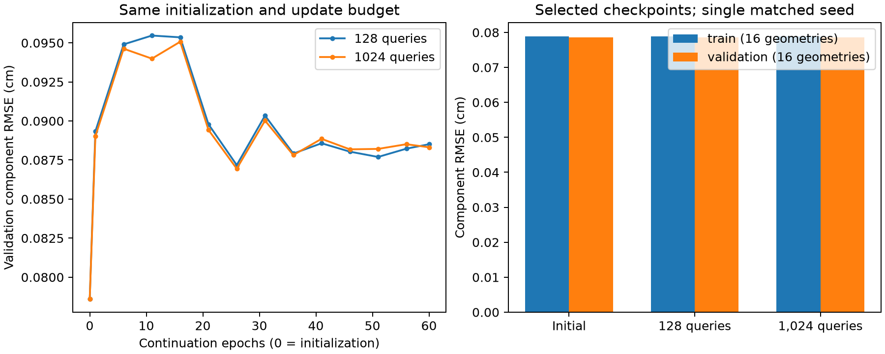

Two-level cardiac mesh sensitivity: uniform tetrahedral refinement of the same polyhedral domain, retaining boundary labels and interpolating the same continuous P1 fiber fields; original mechanics and timestep retained. This checks displacement discretization, without curved-geometry refinement or independent anatomy.

| Pressure(Pa) | Relative volume-L2 displacement difference | Volume-weighted component RMSE(µm) | Minimum refined endpoint detF |
|---|---:|---:|---:|
| 4017.74 | 2.815% | 1.090 | 0.994296 |
| 8035.48 | 2.820% | 2.190 | 0.988481 |
| 16070.95 | 2.827% | 4.412 | 0.976539 |

Mesh sizes: 17625 to 141000 tetrahedra. Boundary areas and reference volume match to numerical tolerance. Two levels do not establish an asymptotic convergence rate or a mesh-independent truth. Surrogate error against the original mesh does not include this reference discretization uncertainty.

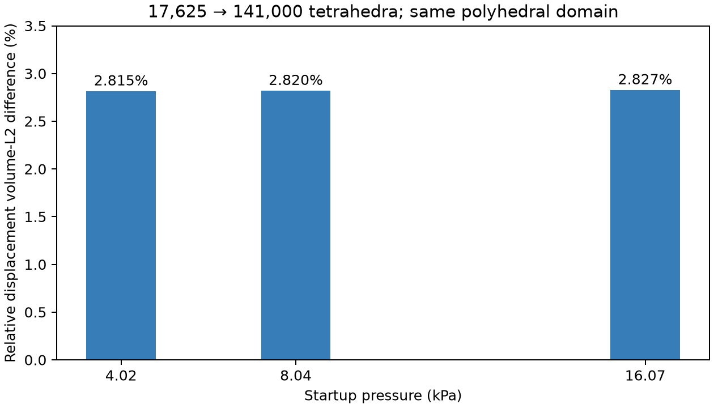

Trusted cardiac first-step probe now converged: normalized residual 5.24e-11, minimum detF 0.9999762, inverted elements 0%. This is oneP1 dynamic timestep, not a full cardiac trajectory or matched Dalton FEM timing. The former native crash was isolated to PETSc LU option initialization; the workaround preserves governing forms.

Separate cardiac startup experiment:20 training,6 validation and6 test LOAD cases on ONE geometry; P1/fibers, passive anisotropic viscoelastic dynamics, zero initial histories. This is not a full-cycle benchmark or a shape-generalization result.

| Matched graph/POD model | Test component RMSE(m) | Normalized force RMS | Strain Frobenius error |
|---|---:|---:|---:|
| data_only | 5.92726e-07 | 0.000111396 | 0.000111019 |
| physics_lambda1 | 5.92969e-07 | 0.000111474 | 0.000111061 |

Physics weight selected on validation only: physics_lambda1; within10% displacement degradation constraint: True. One matched seed,500updates/model; no population-level significance claim. Full weak residual includes follower pressure, inertia, viscosity and natural epi/base Robin terms. POD rank4 is fitted on training cases only.

No residual improvement observed in this matched fixed-geometry startup pilot; do not claim H1 support.

Matched cardiac startup CPU/float64 timings: surrogate median 16.645ms; warm FEM median 1026.367ms; ratio 61.7×. Same host and two-thread settings; inference/corpus/training costs separate. This ratio applies only to the one-step fixed-geometry task and its measured errors, not Dalton or full cardiac cycles.

Full-node Dalton inference timing (batch1,100repetitions; inverse normalization included; resident preprocessed inputs):
- cpu: one model 3.363ms median; five-member ensemble 16.703ms median. No matched Dalton FEM speedup.
- mps: one model 1.381ms median; five-member ensemble 5.914ms median. No matched Dalton FEM speedup.

Observed training cost: full-data graph ensemble stages summed 1083.5s; cardiac data/physics validation grid 406.0s plus summed corpus solver steps 39.4s. These costs are separate from latency ratios and exclude installation/diagnostics.

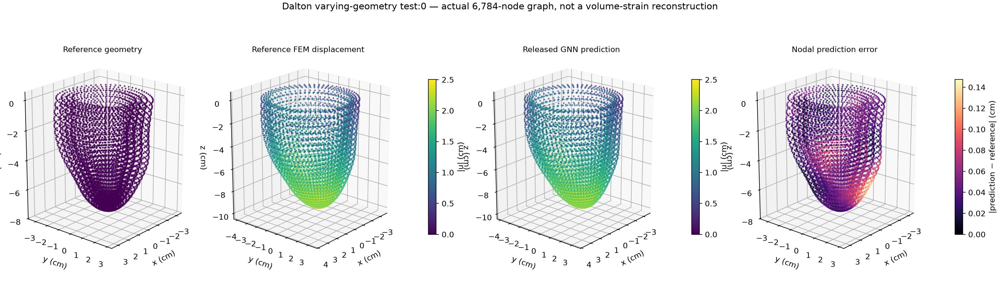

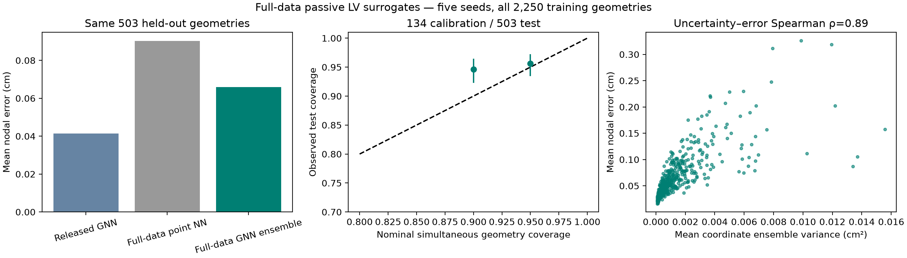
